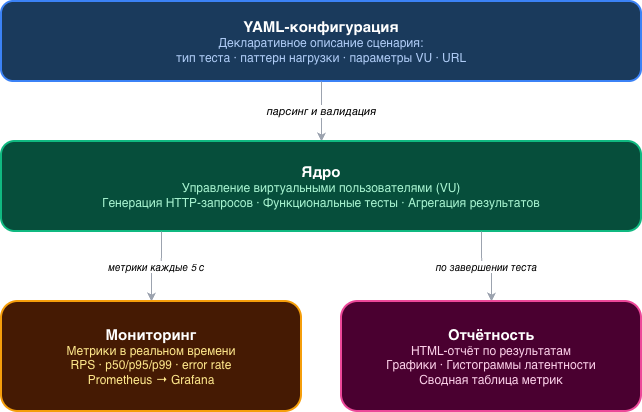
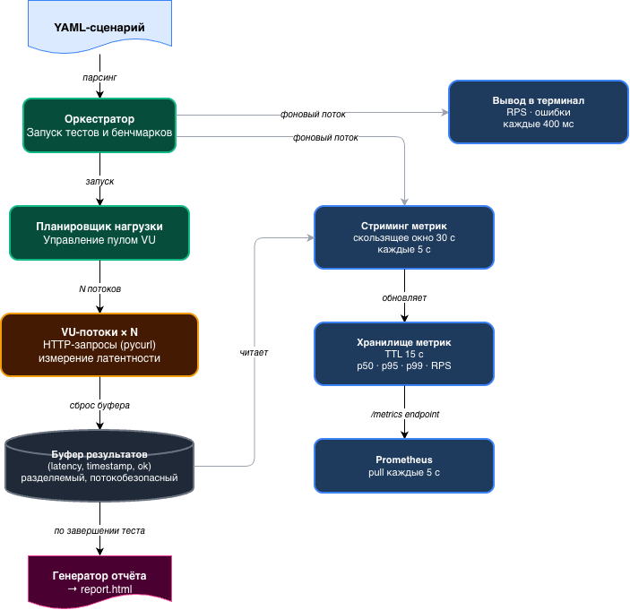
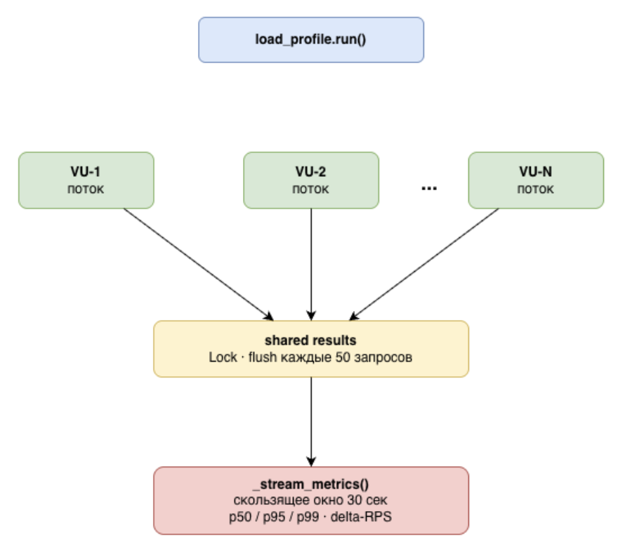
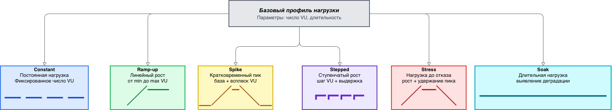
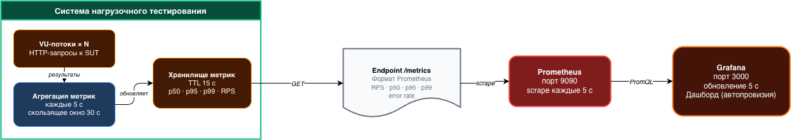
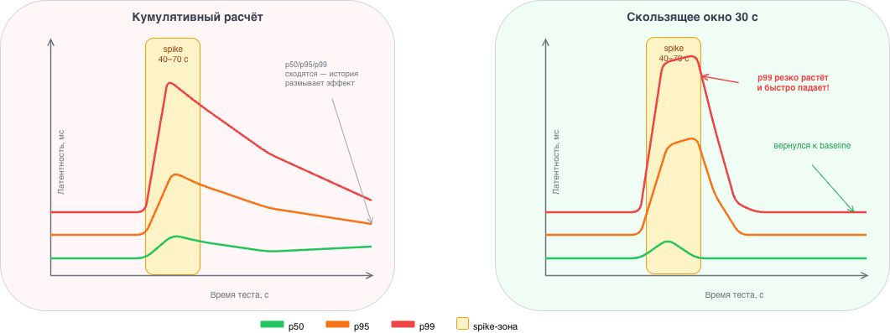
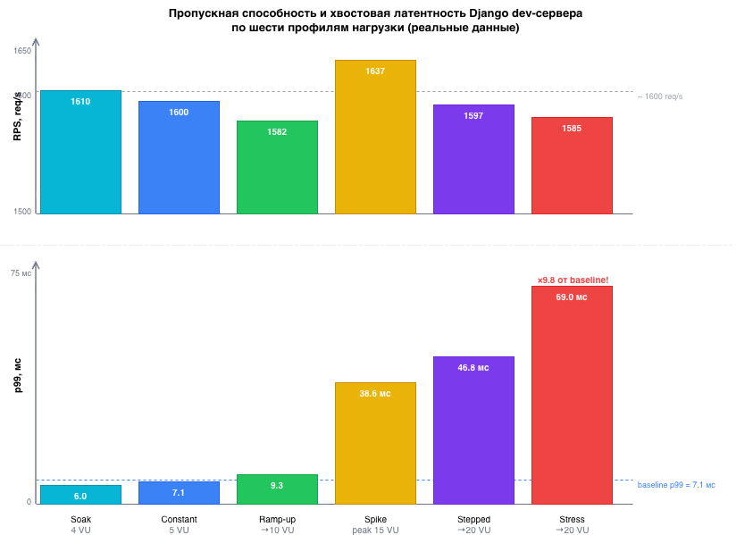

# 2 Проектирование и архитектура системы нагрузочного тестирования

## 2.1 Требования к системе

### 2.1.1 Функциональные требования

На основе сравнительного анализа существующих программных средств и целевых сценариев использования сформулированы функциональные требования к разрабатываемой системе:

1. Описание сценариев нагрузочного тестирования в декларативном YAML-формате без написания программного кода.
2. Поддержка шести паттернов нагрузки: `constant`, `ramp_up`, `spike`, `stepped`, `stress`, `soak`.
3. Сбор метрик латентности (p50, p95, p99) с использованием скользящего окна для актуальности значений.
4. Экспорт метрик в формате Prometheus exposition format.
5. Генерация самодостаточного HTML-отчёта с графиками и гистограммами.
6. Поддержка функциональных тестов (валидация статус-кодов, заголовков, JSON-полей).
7. Механизм привязки переменных для передачи значений между запросами (extract → bind).
8. Расширяемость через плагины без изменения ядра системы.

### 2.1.2 Нефункциональные требования

– Язык реализации: Python 3.8+.
– HTTP-клиент: pycurl (libcurl).
– Минимальный набор зависимостей: pyyaml, pycurl.
– Запуск через CLI без GUI.
– Стриминг метрик в Prometheus каждые 5 секунд в ходе выполнения теста.

## 2.2 Архитектура системы

### 2.2.1 Верхнеуровневая структура

Система perftest состоит из четырёх слоёв, взаимодействующих по вертикали (см. рисунок 2.1):

– **YAML-конфигурация** — декларативное описание сценариев (input);
– **Ядро** — парсинг, управление VU, HTTP-клиент, агрегация метрик;
– **Мониторинг** — Prometheus-экспортер, стриминг в реальном времени;
– **Отчётность** — HTML-отчёт после завершения теста.



*Рисунок 2.1 — Верхнеуровневая архитектура системы perftest*

### 2.2.2 Поток выполнения

Поток выполнения одного бенчмарка включает следующие этапы:

1. **Парсинг**: `parsing.py` разбирает YAML-файл и создаёт объекты `TestSet`, `BenchmarkConfig`.
2. **Запуск**: `resttest.py` получает конфигурацию, создаёт экземпляр профиля нагрузки и запускает пул VU-потоков.
3. **Выполнение**: каждый VU-поток (`_vu_worker`) в бесконечном цикле выполняет HTTP-запросы через pycurl и накапливает результаты в локальном буфере.
4. **Стриминг метрик**: фоновый поток `_stream_metrics` каждые 5 секунд читает буферы VU, вычисляет метрики и отправляет их в `_MetricsStore`.
5. **Prometheus**: HTTP-сервер `metrics_exporter.py` отвечает на запросы Prometheus по эндпоинту `/metrics`.
6. **Завершение**: после окончания фазы `reporter.py` строит HTML-отчёт из всех собранных данных.



*Рисунок 2.2 — Поток выполнения бенчмарка*

### 2.2.3 Проектирование YAML-формата

Центральное архитектурное решение — декларативный YAML-формат описания сценариев. Формат спроектирован по принципу «минимальный обязательный набор полей» — простейший бенчмарк описывается тремя строками, а полный сценарий с функциональными тестами, валидаторами и несколькими профилями нагрузки — в едином файле без написания кода.

YAML-файл состоит из трёх типов блоков верхнего уровня:

*Таблица 2.3 — Типы блоков YAML-сценария*

| Ключ | Тип | Описание |
| --- | --- | --- |
| `config` | Список | Глобальные настройки: имя набора тестов (`testset`) |
| `test` | Список | Функциональные HTTP-тесты с валидаторами |
| `benchmark` | Список | Нагрузочный бенчмарк с профилем нагрузки |

Листинг 2.1 демонстрирует полный YAML-сценарий, включающий функциональный тест и три нагрузочных бенчмарка с разными профилями:

```yaml
- config:
    - testset: "REST API Load Test"

- test:
    - name: "Smoke: GET /api/person/"
    - url: "/api/person/"
    - expected_status: [200]
    - validators:
        - compare: {header: "Content-Type", comparator: contains, expected: "application/json"}
        - extract_binds:
            - id: {jsonpath_mini: "objects.0.id"}

- benchmark:
    - name: "Constant baseline (5 VU, 2 min)"
    - url: "/api/person/"
    - load_profile:
        type: constant
        concurrent_users: 5
        duration: 120

- benchmark:
    - name: "Ramp-up saturation search (1→10 VU, 2 min)"
    - url: "/api/person/"
    - load_profile:
        type: ramp_up
        start_users: 1
        end_users: 10
        duration: 120

- benchmark:
    - name: "Spike resilience (base=3, peak=15)"
    - url: "/api/person/"
    - load_profile:
        type: spike
        base_users: 3
        peak_users: 15
        spike_duration: 30
        base_duration: 45
```

*Листинг 2.1 — Пример YAML-сценария с функциональным тестом и тремя бенчмарками*

Ключевые проектные решения при разработке формата:

**Единый файл**: функциональные тесты и нагрузочные бенчмарки описываются в одном YAML-файле. Это позволяет выполнять smoke-тест (проверка корректности API) перед нагрузочным прогоном без написания отдельных конфигураций.

**Блок `load_profile` как вложенный словарь**: параметры профиля инкапсулированы в отдельный блок, а обязательный набор ключей зависит от типа профиля — при добавлении нового профиля формат расширяется без изменения синтаксиса остальных блоков.

**Нормализация значений**: `parsing.py` выполняет приведение типов (строки → числа), подстановку переменных из контекста `binding.py` и нормализацию относительных URL (конкатенация `base_url` + `url`). Это снимает с пользователя необходимость указывать полный URL в каждом тесте.

### 2.2.4 Функциональные тесты и механизм валидации

Perftest поддерживает два режима работы: функциональное тестирование (блок `test`) и нагрузочное тестирование (блок `benchmark`). Функциональные тесты выполняются последовательно до запуска нагрузочного прогона и позволяют верифицировать корректность API при изменении кода.

Система валидации реализована через два механизма:

**Компараторы** проверяют поля ответа по условию: `compare: {jsonpath_mini: "status", comparator: equals, expected: "ok"}`. Встроенные компараторы: `equals`, `not_equals`, `contains`, `not_contains`, `greater_than`, `less_than`, `regex`.

**Экстракторы** извлекают значения из ответа и сохраняют их в контекст для использования в следующих запросах: `extract_binds: [{token: {jsonpath_mini: "auth.token"}}]`. После извлечения переменная `{token}` подставляется в заголовки или тело следующего запроса.

*Таблица 2.4 — Типы валидаторов и экстракторов*

| Тип | Описание | Пример |
| --- | --- | --- |
| `expected_status` | Список допустимых HTTP-кодов | `[200, 201]` |
| `compare` (header) | Сравнение значения HTTP-заголовка | `Content-Type contains application/json` |
| `compare` (jsonpath_mini) | Сравнение JSON-поля по JSONPath | `objects.0.id equals 1` |
| `extract_binds` (jsonpath_mini) | Извлечение JSON-поля в переменную | `id: objects.0.id` |
| `extract_binds` (regex) | Извлечение по регулярному выражению | `token: Bearer (.+)` |

Механизм привязки переменных (`binding.py`) обеспечивает передачу данных между запросами, что критично для тестирования аутентификации: первый запрос получает JWT-токен, остальные подставляют его в заголовок `Authorization`.

## 2.3 Проектирование потоковой модели VU

### 2.3.1 Обоснование выбора threading

Реализация параллельной генерации нагрузки в Python требует выбора модели параллелизма. Рассмотрены три варианта.

*Таблица 2.1 — Сравнение моделей параллелизма для генерации нагрузки*

| Модель | GIL | I/O параллелизм | CPU параллелизм | Сложность |
| --- | --- | --- | --- | --- |
| `threading` | Освобождается при I/O | Да | Нет | Низкая |
| `multiprocessing` | Нет (отдельные процессы) | Да | Да | Высокая |
| `asyncio` + `aiohttp` | Освобождается при I/O | Да | Нет | Средняя |

Нагрузочное тестирование REST API — задача I/O-bound: большую часть времени поток ожидает ответа сервера. При вызове `curl.perform()` pycurl вызывает C-код libcurl, который освобождает GIL — несколько потоков действительно работают параллельно в ожидании ответов [18]. Модель `threading` выбрана как наиболее простая и достаточная для целевого класса задач.

### 2.3.2 Цикл виртуального пользователя

Каждый VU-поток выполняет цикл:

```
while not stop_event.is_set():
    t_start = time.time()
    выполнить HTTP-запрос через pycurl
    t_end = time.time()
    latency = (t_end - t_start) * 1000  # мс
    добавить в локальный буфер (latency, timestamp, success)
    если len(local_buffer) >= 50:
        сбросить в общий список под Lock
```

Схема взаимодействия потоков VU с общим буфером результатов и потоком стриминга метрик представлена на рисунке 2.2.



*Рисунок 2.3 — Схема параллельной генерации нагрузки: VU-потоки → shared results → _stream_metrics()*

Периодический flush (каждые 50 запросов) под `threading.Lock` обеспечивает компромисс между contention (частые блокировки) и задержкой поступления данных для стриминга (редкие блокировки). При N VU потоки суммарно сбрасывают данные N × (частота flush) раз в секунду — при типичной латентности 5–10 мс и 50 запросах на flush это порядка 10–100 сбросов в секунду, что незначительно по сравнению с суммарным числом запросов.

### 2.3.3 Хранилище метрик

Глобальный список латентностей разделён между VU-потоками. Поток `_stream_metrics` читает его каждые 5 секунд и:

1) вычисляет перцентили по скользящему окну (последние 30 секунд);
2) вычисляет delta-RPS как число запросов за последние 5 секунд, делённое на 5;
3) передаёт значения в `_MetricsStore`.

## 2.4 Проектирование профилей нагрузки

### 2.4.1 Иерархия классов

Все профили нагрузки наследуются от абстрактного класса `_BaseProfile`:

```python
class _BaseProfile:
    def run(self, benchmark, config, results):
        raise NotImplementedError
```

Каждый конкретный профиль переопределяет метод `run()` и реализует логику управления пулом VU-потоков. Добавление нового профиля сводится к написанию одного класса и регистрации его в словаре `PROFILE_TYPES`:

```python
PROFILE_TYPES = {
    'constant': ConstantProfile,
    'ramp_up': RampUpProfile,
    'spike': SpikeProfile,
    'stepped': SteppedProfile,
    'stress': StressProfile,
    'soak': SoakProfile,
}
```



*Рисунок 2.4 — Иерархия классов профилей нагрузки*

### 2.4.2 Управление пулом VU-потоков

Каждый профиль управляет пулом потоков с помощью `threading.Event` для мягкой остановки:

– **Добавление VU**: создаётся новый поток `_vu_worker` с уникальным `stop_event`; поток стартует немедленно.
– **Удаление VU**: выбирается один из активных потоков, ему устанавливается `stop_event`; поток завершается после текущего запроса, не прерывая его на полуслове.
– Мягкая остановка гарантирует, что каждый измеренный запрос будет полностью завершён и попадёт в итоговую статистику.

### 2.4.3 Профиль constant

**Назначение:** базовая нагрузка — фиксированное число N VU работает на протяжении всего времени теста. Используется как эталонная точка: результаты всех остальных профилей сравниваются с результатами `constant`.

**Алгоритм:**

1. Запустить N потоков `_vu_worker`.
2. Ждать `duration` секунд.
3. Остановить все потоки через `stop_event.set()`.

**Параметры:** `concurrent_users` (N), `duration` (секунды).

**Ожидаемое поведение:** RPS стабилен на протяжении теста; p50, p95, p99 — горизонтальные линии. Отклонение от горизонтальности указывает на нестабильность тестируемого сервиса.

**Связь с экспериментом:** при 5 VU зафиксированы RPS 1 599.81 req/s, p99 7.053 мс — используется как базовое значение (baseline) для сравнения с другими профилями.

### 2.4.4 Профиль ramp_up

**Назначение:** поиск точки насыщения. Число VU линейно растёт от `start_users` до `end_users` за `duration` секунд. Позволяет увидеть, при каком числе VU начинается деградация латентности.

**Алгоритм:**

1. Запустить `start_users` потоков.
2. Вычислить интервал добавления: `dt = duration / (end_users - start_users)`.
3. Каждые `dt` секунд добавлять один поток, пока не достигнуто `end_users`.
4. Дождаться завершения фазы по таймеру.

**Параметры:** `start_users`, `end_users`, `duration`.

**Ожидаемое поведение:** RPS растёт до точки насыщения, затем выходит на плато. p50 растёт медленно; p99 начинает расти резче после точки насыщения — именно этот «излом» фиксирует момент перехода в режим очереди (ρ → 1 по модели M/M/1). В эксперименте при переходе от 5 к 10 VU RPS выходил на плато ~1 600 req/s.

### 2.4.5 Профиль spike

**Назначение:** проверка устойчивости к внезапному пику трафика. Моделирует flash-mob: резкий скачок нагрузки, удержание и возврат к базовому уровню.

**Алгоритм:**

1. Запустить `base_users` потоков.
2. Мгновенно добавить потоки до `peak_users` (скачок вверх).
3. Ждать `spike_duration` секунд (удержание пика).
4. Мгновенно удалить потоки до `base_users` (возврат к базе).
5. Ждать `base_duration` секунд (наблюдение за восстановлением).

**Параметры:** `base_users`, `peak_users`, `spike_duration`, `base_duration`.

**Ожидаемое поведение:** p99 резко растёт в момент скачка и так же резко снижается после возврата к базовому уровню — именно это поведение некорректно отображают кумулятивные перцентили, но правильно показывает скользящее окно. В эксперименте при скачке до 15 VU p99 = 38.586 мс (в 5.5 раза выше baseline 7.053 мс).

### 2.4.6 Профиль stepped

**Назначение:** точное определение точки деградации. В отличие от `ramp_up` с непрерывным ростом, `stepped` даёт системе время стабилизироваться на каждом уровне нагрузки. Горизонтальные плато на графике delta-RPS соответствуют каждой ступени.

**Алгоритм:**

1. Запустить `start_users` потоков.
2. Через `step_duration` секунд добавить `step_users` потоков.
3. Повторять шаг 2, пока не достигнуто `end_users`.
4. Завершить фазу.

**Параметры:** `start_users`, `end_users`, `step_users`, `step_duration`.

**Ожидаемое поведение:** на каждой ступени RPS и перцентили стабилизируются на горизонтальном плато; при переходе к следующей ступени — мгновенный скачок. Ступень, на которой p99 начинает расти непропорционально быстро относительно прироста RPS, и есть точка деградации. В эксперименте (5→20 VU, 4 шага × 45 с) p99 достигло 46.807 мс.

### 2.4.7 Профиль stress

**Назначение:** определение абсолютного предела производительности и проверка восстановления. Нагрузка нарастает до максимального значения, удерживается и снижается — что позволяет проверить, восстанавливается ли сервис после экстремальной нагрузки.

**Алгоритм:**

1. Линейно нарастить число VU от `start_users` до `peak_users` за `ramp_duration` секунд (аналогично `ramp_up`).
2. Удерживать `peak_users` в течение `hold_duration` секунд.
3. Линейно снизить до `start_users` за `ramp_down_duration` секунд (удаление VU).

**Параметры:** `start_users`, `peak_users`, `ramp_duration`, `hold_duration`.

**Ожидаемое поведение:** максимальные значения p99 фиксируются в фазе удержания; после снижения нагрузки p99 должен вернуться к базовым значениям, что подтверждает отсутствие деградации состояния сервиса (утечек соединений, накопленных транзакций). В эксперименте (1→20 VU, hold 90 с) p99 = 69.044 мс — максимальное значение среди всех профилей.

### 2.4.8 Профиль soak

**Назначение:** обнаружение деградации при длительной нагрузке — утечек памяти, накопления открытых соединений, фрагментации кучи. В отличие от `constant`, `soak` применяется с умеренным числом VU, но на существенно более длительное время (от 30 минут до нескольких часов в production-сценариях).

**Алгоритм:** идентичен `constant` — N потоков на протяжении `duration` секунд. Различие в семантике: `constant` используется для измерения baseline-метрик, `soak` — для обнаружения нарастающего тренда в перцентилях.

**Параметры:** `concurrent_users`, `duration`.

**Ожидаемое поведение:** если сервис имеет утечку памяти, p99 будет монотонно нарастать со временем. Стабильные горизонтальные метрики — признак корректного управления ресурсами. В эксперименте (4 VU, 120 с) p99 = 6.022 мс — наименьшее значение среди всех профилей, подтверждающее отсутствие деградации при умеренной нагрузке.

*Таблица 2.5 — Сводная характеристика шести профилей нагрузки*

| Профиль | Форма N(t) | Ключевой вопрос | Результат эксперимента (p99) |
| --- | --- | --- | --- |
| `constant` | ——— | Стабильна ли нагрузка при N=const? | 7.053 мс (baseline) |
| `ramp_up` | ╱‾‾‾ | При каком N начинается деградация? | 9.313 мс (→10 VU) |
| `spike` | \_╱‾╲\_ | Как система переносит пиковый всплеск? | 38.586 мс (peak 15 VU) |
| `stepped` | ⌐⌐⌐⌐ | На какой ступени появляется очередь? | 46.807 мс (→20 VU) |
| `stress` | ╱‾‾╲ | Каков абсолютный предел и есть ли восстановление? | 69.044 мс (hold 20 VU) |
| `soak` | ——— | Есть ли нарастающая деградация? | 6.022 мс (4 VU, stable) |

## 2.5 Проектирование мониторинга

### 2.5.1 Архитектура Prometheus-экспортера

`_MetricsStore` — in-memory хранилище текущих значений метрик с TTL 15 секунд. Когда бенчмарк завершается, новые данные перестают поступать; через 15 секунд запись истекает и `/metrics` возвращает пустой ответ. Это предотвращает «протечку» метрик одной фазы в следующую.

Экспортируемые метрики:

*Таблица 2.2 — Метрики, экспортируемые в Prometheus*

| Имя метрики | Тип | Описание |
| --- | --- | --- |
| `perftest_rps` | Gauge | Delta-RPS за последние 5 секунд |
| `perftest_error_rate` | Gauge | Доля ошибок |
| `perftest_latency_quantile_seconds` | Gauge | Перцентили (лейбл `quantile`) |
| `perftest_active_vus` | Gauge | Текущее число активных VU |
| `perftest_total_requests` | Counter | Накопленное число запросов |

Использование лейбла `{quantile="p95"}` вместо отдельного имени метрики (`perftest_latency_p95_seconds`) позволяет фильтровать значения в PromQL через `=~"$percentile"` — стандартный подход для шаблонных переменных Grafana.



*Рисунок 2.5 — Пайплайн мониторинга: VU-потоки → агрегация метрик → Prometheus → Grafana*

### 2.5.2 Скользящее окно перцентилей

Ключевое проектное решение — расчёт перцентилей по скользящему окну 30 секунд, а не кумулятивно с начала теста. Обоснование: при нагрузочном тесте с профилем `spike` (1 → 100 VU → 1 VU) кумулятивные перцентили после спайка медленно снижаются, отражая историю, а не текущее состояние. Скользящее окно даёт актуальную картину: p99 резко растёт во время спайка и быстро снижается после него (см. рисунок 2.6).



*Рисунок 2.6 — Сравнение кумулятивных и скользящих перцентилей для профиля spike*

### 2.5.3 Конфигурация Grafana через provisioning

Дашборд Grafana конфигурируется через три файла:

– `grafana-datasource.yml` — источник данных Prometheus;
– `grafana-dashboards.yml` — путь для автозагрузки JSON-дашбордов;
– `dashboard.json` — описание дашборда с панелями.

Критическое решение: поле `datasource` в `dashboard.json` должно содержать строковый UID `"Prometheus"`, а не шаблонную переменную `${DS_PROMETHEUS}` (которая разрешается только при ручном импорте через UI). При использовании provisioning шаблонная переменная не подставляется, и дашборд загружается с неразрешённым источником данных.

## 2.6 Проектирование HTML-отчёта

Отчёт — самодостаточный HTML-файл: все зависимости (Chart.js) подключаются через CDN или встраиваются inline. Структура отчёта для каждой фазы бенчмарка:

1. Таблица перцентилей (mean, p50, p95, p99, std, error rate, total requests).
2. График RPS и error rate по времени (линейный, оси времени по X).
3. Гистограмма распределения латентности.

Для гистограммы применяется отсечение выбросов: верхняя граница бакетов = p99 × 1.2. Это решает проблему вырождения гистограммы, когда один-два выброса (например, 2000 мс при медиане 5 мс) растягивают шкалу до такой степени, что 99% значений попадают в первый бакет.

## 2.7 Тестовый сервис

### 2.7.1 Обоснование выбора Django + Tastypie

Для экспериментальной оценки системы разработан тестовый сервис на Django + django-tastypie. Причины выбора:

– **Изоляция замеров**: в отличие от публичных API (jsonplaceholder.typicode.com, httpbin.org), собственный сервис не имеет rate limiting и добавляет только предсказуемую задержку обработки.
– **SQLite in-memory**: база данных создаётся в памяти при старте, не сохраняется на диск; это исключает влияние дисковых I/O на результаты.
– **Знакомость**: Django — популярный Python-фреймворк, понятный аудитории работы.

### 2.7.2 Предел производительности и точка насыщения

Django `runserver` — однопоточный WSGI-сервер из стандартной библиотеки Python: он принимает одно соединение, полностью обрабатывает запрос и только затем принимает следующее. Теоретический предел:

$$
RPS_{max} = \frac{1}{T_{req}} \approx \frac{1}{0.6 \text{ мс}} \approx 1\,666 \text{ req/s} \tag{2.1}
$$

где $T_{req}$ — время обработки одного запроса (~0.6 мс для простого CRUD). При N > 15 VU RPS перестаёт расти и выходит на плато ~1 600 req/s, а p95/p99 начинают быстро расти — классическая картина насыщения (см. рисунок 2.7). Это намеренное ограничение демо-стенда: именно на нём хорошо видна точка насыщения.



*Рисунок 2.7 — Зависимость RPS и p99 от числа VU (Django runserver)*

## 2.8 Выводы

Ключевое проектное решение всей системы — декларативный YAML-файл как единая точка входа: один файл описывает и функциональные тесты (с валидаторами и привязкой переменных), и нагрузочные бенчмарки с выбором профиля. Это позволяет запускать smoke-тест перед нагрузочным прогоном без отдельной конфигурации.

Выбор модели потоков на pycurl, а не coroutines, объясняется тем, что libcurl освобождает GIL во время C-вызова — N потоков работают параллельно при сетевом ожидании без дополнительных усилий. Для задачи генерации нагрузки на локальный Django-сервер этого достаточно.

Три ключевых решения (скользящее окно для перцентилей, delta-RPS и TTL-фильтрация метрик) взаимосвязаны: все три нужны для того, чтобы дашборд Grafana отображал то, что происходит прямо сейчас, а не усреднение за всё время теста. Без них визуализация spike-паттерна выглядит как плавная кривая без пика.
