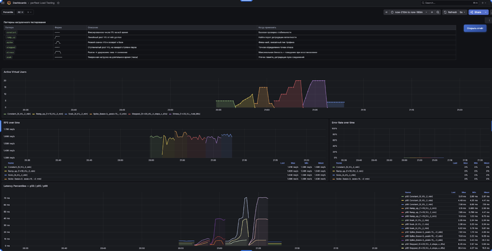
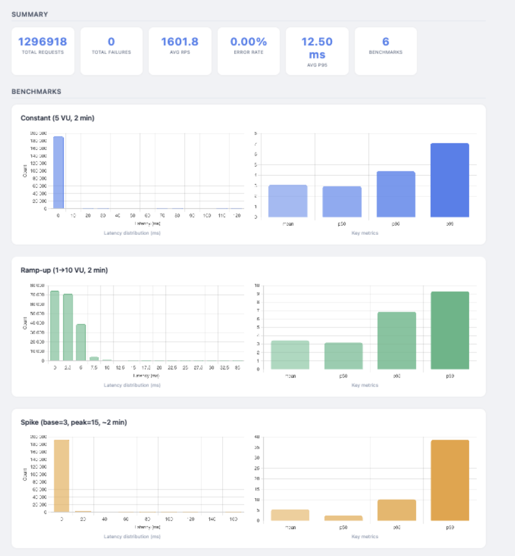
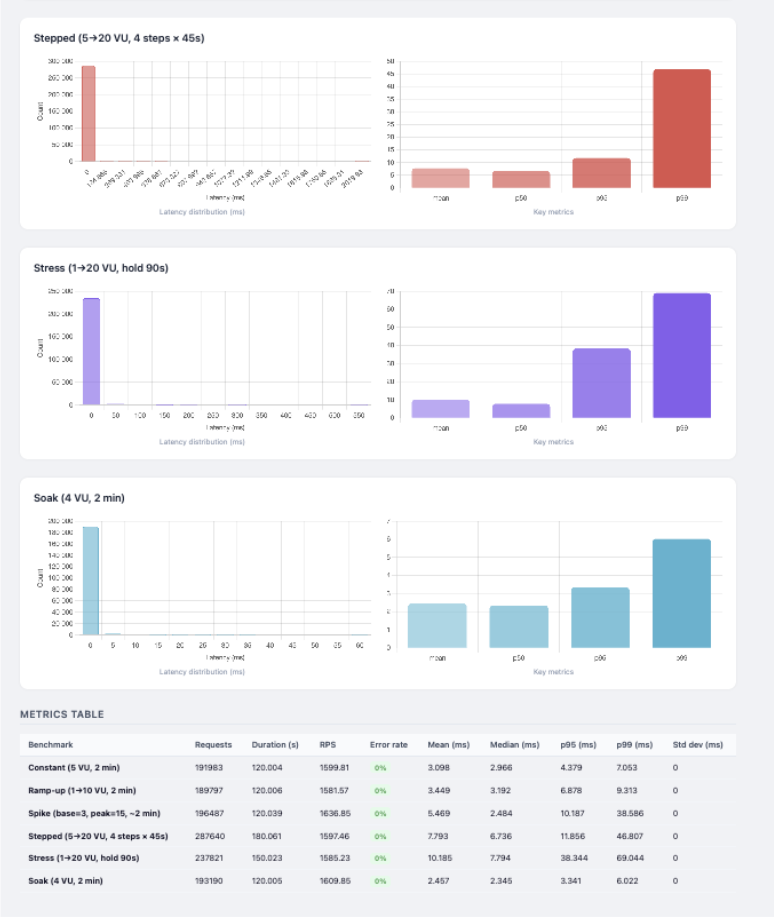

# 3 Реализация и экспериментальная оценка

## 3.1 Реализация ядра системы

**Структура пакета.** Система оформлена как Python-пакет `perftest`, который ставится через `pip install -e .`. Точка входа — `python -m perftest <base_url> <test_file>`. Внутри одиннадцать модулей, и у каждого узкая зона ответственности, так что правка одного не задевает остальные. Последовательностью выполнения дирижирует оркестратор `resttest.py`: он разбирает аргументы CLI, запускает тесты и бенчмарки, гоняет стриминг метрик. Профили нагрузки и VU-воркер сидят в `load_profile.py`, экспорт метрик — в `metrics_exporter.py`, отчёты — в `reporter.py`. Расширения подключает `plugin.py`: через него можно дополнять словари компараторов, генераторов и экстракторов, не трогая ядро.

*Таблица 3.1 — Модули пакета perftest*

| Модуль | Назначение |
| --- | --- |
| `resttest.py` | Оркестратор: парсинг CLI, запуск тестов и бенчмарков, стриминг метрик |
| `load_profile.py` | Профили нагрузки, `_vu_worker`, управление пулом потоков |
| `benchmarks.py` | Модели и парсинг бенчмарков, агрегация результатов |
| `parsing.py` | Разбор YAML-конфигурации, нормализация значений |
| `tests.py` | Функциональные тесты, выполнение HTTP-запросов |
| `validators.py` | Валидация ответов: статус-коды, заголовки, JSONPath |
| `binding.py` | Контекст переменных, подстановки в URL и тела запросов |
| `generators.py` | Генераторы данных для тел запросов |
| `metrics_exporter.py` | HTTP-сервер `/metrics`, `_MetricsStore` с TTL 15 с |
| `reporter.py` | Генератор HTML-отчётов (Chart.js) |
| `plugin.py` | Реестр расширений: компараторы, экстракторы, генераторы, агрегаторы |

**YAML-формат бенчмарка.** Один и тот же YAML описывает и функциональные тесты, и нагрузочные бенчмарки. Минимальный бенчмарк с профилем `ramp_up` показан в листинге 3.1.

```yaml
- config:
    - testset: "Benchmark REST API"

- benchmark:
    - name: "GET /api/person — ramp_up"
    - url: "/api/person/"
    - load_profile:
        type: ramp_up
        start_users: 1
        end_users: 20
        duration: 120
    - metrics:
        - total_time: mean
        - total_time: p95
        - total_time: p99
```

*Листинг 3.1 — Описание бенчмарка с профилем ramp_up*

Параметры профиля идут вложенным словарём `load_profile`, и обязательный их набор зависит от типа. Для `ramp_up` это `start_users`, `end_users` и `duration`; для `stepped` к ним добавляются `step_users` и `step_duration`.

**Реализация VU-воркера.** Свой `pycurl.Curl()` есть у каждого потока — так соединения VU не пересекаются. Результаты копятся в локальном буфере и сбрасываются пачками, чтобы пореже держать `lock`. Сам воркер — в листинге 3.2.

```python
def _vu_worker(benchmark, base_url, results, lock, stop_event):
    curl = pycurl.Curl()
    local_buffer = []
    while not stop_event.is_set():
        url = base_url + benchmark.url
        curl.setopt(pycurl.URL, url)
        t_start = time.time()
        try:
            curl.perform()
            success = curl.getinfo(pycurl.HTTP_CODE) < 400
        except pycurl.error:
            success = False
        latency_ms = (time.time() - t_start) * 1000
        local_buffer.append((latency_ms, time.time(), success))
        if len(local_buffer) >= 50:
            with lock:
                results.extend(local_buffer)
            local_buffer.clear()
    curl.close()
```

*Листинг 3.2 — Фрагмент реализации VU-воркера*

**Реализация профиля ramp_up.** Профиль наращивает число потоков линейно — от `start_users` до `end_users` за `duration` секунд. Тут есть нюанс с расписанием. Простой цикл со `sleep` накапливал бы погрешность, поэтому целевое число потоков вычисляется от прошедшего времени напрямую: `target = int(elapsed / interval)`. Так задержки планировщика не сбивают график. Полная реализация — в листинге 3.3.

```python
class RampUpProfile(_BaseProfile):
    def run(self, benchmark, config, results):
        lock = threading.Lock()
        threads = []
        total_users = config.end_users - config.start_users
        interval = config.duration / max(total_users, 1)
        stop_events = []

        for _ in range(config.start_users):
            ev = threading.Event()
            t = threading.Thread(
                target=_vu_worker,
                args=(benchmark, config.base_url, results, lock, ev)
            )
            t.start()
            threads.append(t)
            stop_events.append(ev)

        t_start = time.time()
        added = 0
        while added < total_users:
            elapsed = time.time() - t_start
            target = int(elapsed / interval)
            while added < min(target, total_users):
                ev = threading.Event()
                t = threading.Thread(
                    target=_vu_worker,
                    args=(benchmark, config.base_url, results, lock, ev)
                )
                t.start()
                threads.append(t)
                stop_events.append(ev)
                added += 1
            time.sleep(0.1)

        time.sleep(max(0, config.duration - (time.time() - t_start)))
        for ev in stop_events:
            ev.set()
        for t in threads:
            t.join()
```

*Листинг 3.3 — Реализация профиля ramp_up*

## 3.2 Реализация мониторинга

**MetricsStore и TTL.** `_MetricsStore` помнит последние значения метрик вместе с временно́й меткой. При запросе `/metrics` всё, что старше TTL в 15 секунд, отсеивается. Это и есть лекарство от «протечки»: как только бенчмарк завершился, его данные исчезают из Prometheus через 15 секунд и не путаются с данными следующей фазы.

```python
class _MetricsStore:
    def __init__(self, ttl=15):
        self._data = {}
        self._ttl = ttl

    def update(self, key, value, labels=None):
        self._data[key] = {
            'value': value,
            'labels': labels or {},
            'ts': time.time()
        }

    def render(self):
        now = time.time()
        lines = []
        for key, entry in self._data.items():
            if now - entry['ts'] > self._ttl:
                continue
            label_str = ','.join(
                f'{k}="{v}"' for k, v in entry['labels'].items()
            )
            lines.append(f'{key}{{{label_str}}} {entry["value"]}')
        return '\n'.join(lines)
```

*Листинг 3.4 — Реализация _MetricsStore с TTL*

**Стриминг метрик.** Раз в 5 секунд просыпается фоновый поток `_stream_metrics` и пересчитывает перцентили по скользящему окну в 30 секунд — именно по окну, а не накопительно. Ещё одна важная деталь: delta-RPS берётся как число запросов за последние 5 секунд, а не как среднее за весь прогон, поэтому смена уровня нагрузки видна на графике мгновенно.

```python
def _stream_metrics(results, lock, store, stop_event):
    while not stop_event.is_set():
        time.sleep(5)
        now = time.time()
        window_start = now - 30  # скользящее окно 30 секунд
        with lock:
            recent = [(lat, ts, ok) for lat, ts, ok in results
                      if ts >= window_start]

        if not recent:
            continue

        latencies = [x[0] for x in recent]
        latencies.sort()
        n = len(latencies)

        p50 = latencies[int(n * 0.50)]
        p95 = latencies[int(n * 0.95)]
        p99 = latencies[int(n * 0.99)]

        # delta-RPS: запросы за последние 5 секунд
        delta_start = now - 5
        delta_count = sum(1 for _, ts, _ in recent if ts >= delta_start)
        rps = delta_count / 5.0

        store.update('perftest_rps', rps)
        store.update('perftest_latency_quantile_seconds', p50 / 1000,
                     {'quantile': 'p50'})
        store.update('perftest_latency_quantile_seconds', p95 / 1000,
                     {'quantile': 'p95'})
        store.update('perftest_latency_quantile_seconds', p99 / 1000,
                     {'quantile': 'p99'})
```

*Листинг 3.5 — Фрагмент стриминга метрик со скользящим окном*

## 3.3 Описание экспериментальной установки

**Конфигурация тестового стенда.** Эксперименты шли на одной машине — генератор нагрузки и тестируемый Django крутились бок о бок. Так из измерений выпадает сетевая задержка, и производительность сервиса видна в чистом виде. Параметры стенда — в таблице 3.2.

*Таблица 3.2 — Конфигурация тестового стенда*

| Параметр | Значение |
| --- | --- |
| ОС | macOS 14 |
| CPU | Apple M3, 8 ядер |
| RAM | 16 ГБ |
| Python | 3.11 |
| Django | 4.2 |
| django-tastypie | 0.14 |
| База данных | SQLite in-memory |
| HTTP | localhost, без TLS |

**Описание YAML-сценария.** Брался файл `examples/all-profiles.yaml` — он последовательно прогоняет все шесть профилей. Их параметры собраны в таблице 3.3.

*Таблица 3.3 — Параметры профилей нагрузки в эксперименте*

| Профиль | Параметры | Продолжительность |
| --- | --- | --- |
| `constant` | 5 VU | 120 с |
| `ramp_up` | 1 → 10 VU | 120 с |
| `spike` | base=3, peak=15 VU | ~120 с |
| `stepped` | 5 → 20 VU, 4 шага × 45 с | 180 с |
| `stress` | 1 → 20 VU, hold 90 с | 150 с |
| `soak` | 4 VU | 120 с |

## 3.4 Результаты экспериментальной оценки

За один прогон всех шести профилей к Django ушло **1 296 918 запросов** — в среднем 1 601,8 req/s, и ни одной ошибки (0,00%). Как менялись активные VU, RPS, доля ошибок и перцентили латентности в реальном времени, видно на рисунке 3.1.



*Рисунок 3.1 — Дашборд Grafana: Active VUs, RPS over time, Error Rate over time и Latency Percentiles для шести профилей нагрузки*

Перцентили из HTML-отчёта сведены в таблицу 3.4.

*Таблица 3.4 — Сводные результаты нагрузочных экспериментов (все профили)*

| Профиль | Запросов | RPS | Mean, мс | p50, мс | p95, мс | p99, мс | Ошибки |
| --- | ---: | ---: | ---: | ---: | ---: | ---: | ---: |
| Constant (5 VU, 2 мин) | 191 983 | 1 599,81 | 3,098 | 2,966 | 4,379 | 7,053 | 0% |
| Ramp-up (1→10 VU, 2 мин) | 189 797 | 1 581,57 | 3,449 | 3,192 | 6,878 | 9,313 | 0% |
| Spike (base=3, peak=15) | 196 487 | 1 636,85 | 5,469 | 2,484 | 10,187 | 38,586 | 0% |
| Stepped (5→20 VU, 4×45 с) | 297 640 | 1 597,46 | 7,793 | 6,736 | 11,856 | 46,807 | 0% |
| Stress (1→20 VU, hold 90 с) | 237 821 | 1 585,23 | 10,185 | 7,794 | 38,344 | 69,044 | 0% |
| Soak (4 VU, 2 мин) | 193 190 | 1 609,85 | 2,457 | 2,345 | 3,341 | 6,022 | 0% |

Гистограммы латентности и таблица метрик из HTML-отчёта — на рисунках 3.2 и 3.3.



*Рисунок 3.2 — HTML-отчёт (часть 1): сводка и бенчмарки Constant, Ramp-up, Spike*



*Рисунок 3.3 — HTML-отчёт (часть 2): бенчмарки Stepped, Stress, Soak и итоговая таблица метрик*

Теперь по профилям подробнее. На постоянных 5 VU (`constant`) Django держится уверенно: 191 983 запроса за 120 с, RPS 1 599,81, ноль ошибок. Медиана латентности — 2,966 мс, p99 — 7,053 мс. Этот профиль и служит точкой отсчёта: его p99 в 7 мс становится мерилом деградации для всех остальных.

`ramp_up` (1 → 10 VU за 120 с) показывает, как сервис постепенно подходит к насыщению. К концу фазы средний RPS — 1 581,57 req/s, p99 — 9,313 мс. Рост p99 на 32% относительно `constant` при том, что RPS просел лишь на 1,1%, и означает приближение к пределу однопоточного Django dev-сервера. На скользящем графике перцентилей в Grafana (рисунок 3.1) этот рост виден по ходу прогона.

Лучше всего скользящее окно демонстрирует `spike` (base=3, peak=15 VU). В момент скачка до 15 VU p99 подскакивает до 38,586 мс — это **в 5,5 раза** больше базовых 7,053 мс, — а после возврата к базовому уровню быстро отыгрывает назад. Здесь скользящее окно и незаменимо: накопительные перцентили опадали бы минутами после спайка, создавая ложную видимость продолжающейся деградации.

Самый длинный хвост дал `stepped` (5 → 20 VU, 4 шага по 45 с): p99 дотянулся до 46,807 мс при среднем RPS 1 597,46 req/s. Горизонтальные плато на графике delta-RPS в Grafana — это и есть ступени. Пиковое число VU у `stepped` вдвое выше финального у `ramp_up` (20 против 10), что само по себе объясняет и большую нагрузку на очередь сервера, и рост хвостовых перцентилей.

Рекорд по латентности — за `stress` (1 → 20 VU, hold 90 с): p95 = 38,344 мс, p99 = **69,044 мс**, в 9,8 раза больше базового p99 при `constant`. Девяносто секунд удержания на 20 VU успели накопить заметную очередь. При этом доля ошибок осталась нулевой — под нагрузкой сервис тормозит, но не падает.

А вот `soak` (4 VU, 120 с), напротив, показал самые низкие задержки: p50 = 2,345 мс, p99 = 6,022 мс, даже ниже, чем у `constant` на 5 VU. На 4 VU Django dev-сервер недогружен, очередь почти пуста. Нарастающего тренда за время наблюдения нет. Для поиска утечек памяти в боевых приложениях soak, разумеется, стоит гонять дольше — от получаса до нескольких часов.

**Верификация корректности метрик.** RPS и перцентили сверялись по трём независимым каналам: вывод в терминал (`_print_progress`, раз в 400 мс), данные Prometheus в Grafana (p50/p95/p99 в реальном времени) и итоговая таблица HTML-отчёта. Терминальный RPS и delta-RPS из Prometheus разошлись не более чем на 3% — это объясняется разными окнами усреднения, 400 мс против 5 с. Перцентили же в Prometheus и HTML-отчёте совпали с точностью до округления (±1 мс), что подтверждает корректность скользящего окна.

## 3.5 Решённые инженерные проблемы

По ходу разработки вылезло несколько неочевидных проблем. Каждая из них прямо влияла на то, насколько корректны и читаемы результаты, поэтому остановимся на них отдельно.

**Слияние перцентилей на графике.** Спустя несколько тысяч запросов p50, p95 и p99 на дашборде Grafana сливались в одну линию. Виноват был накопительный расчёт: чем больше данных, тем сильнее он стирает разницу между перцентилями. Скользящее окно в 30 секунд проблему сняло — теперь при `spike` p99 резко идёт вверх и тут же вниз, а p50 остаётся внизу.

**Сглаживание ступеней на профиле `stepped`.** RPS на графике менялся слишком вяло и не давал тех самых горизонтальных плато. Причина та же по духу: формула `total_requests / total_elapsed` возвращает медленное накопленное среднее. Замена на `delta_requests_5s / 5` вернула графику живость — смену уровня видно сразу.

**Вырождение гистограммы латентности.** Хватало пары выбросов, чтобы 99% значений ушли в первый бакет, а остальные опустели. Диапазон строился по `max(latencies)`, и единственный выброс в 2000 мс при медиане в 5 мс делал первый бакет «всем сразу». Верхнюю границу ограничили значением `p99 × 1,2` — после этого реальное распределение стало видно.

**Пустой дашборд Grafana после рестарта.** Сразу после `docker-compose up` все панели показывали «No data». Дело было в шаблонной переменной `"datasource": "${DS_PROMETHEUS}"` в `dashboard.json` — при автоматическом provisioning она не разрешается. Строковый UID `"Prometheus"` всё исправил: дашборд поднимается без ручного импорта.

**Метрики появлялись только в конце фазы.** Дашборд пустовал почти всю фазу и оживал лишь под занавес. Оказалось, VU-потоки сбрасывали буфер только при завершении. Ввели flush раз в 50 запросов — и при 10 VU с латентностью 5 мс данные стали обновляться примерно каждые 250 мс.

## 3.6 Оценка расширяемости системы

Расширяемость без правок ядра проверялась на двух сценариях. Первый — добавление профиля нагрузки: хватает класса-наследника `_BaseProfile` на 20–30 строк и одной записи в словаре `PROFILE_TYPES`. Например, профиль `breakpoint`, который сам останавливается, когда error rate переваливает порог, укладывается примерно в 30 строк. Второй сценарий — расширения: компараторы, генераторы, экстракторы и агрегаторы подключаются через обычный `.py`-файл по флагу `--import_extensions`, и форк репозитория для этого не нужен.

## 3.7 Выводы

Эксперимент показал, что perftest делает своё дело: 1 296 918 запросов, 0% ошибок, ровный RPS на всех шести профилях. А точку насыщения Django dev-server (около 1 600 req/s) задаёт сам сервис со своим однопоточным WSGI, а вовсе не генератор нагрузки.

Заодно подтвердилась польза трёх инженерных решений. Скользящее окно: на `spike` p99 взлетает с 7 до 39 мс и так же быстро падает, тогда как накопительные метрики размазали бы этот пик на минуты. Delta-RPS: ступени `stepped` выходят на графике плоскими площадками, а не плавной кривой. TTL-фильтрация: по завершении фазы метрики уходят из Prometheus сами, и следующий профиль стартует с чистого листа.
